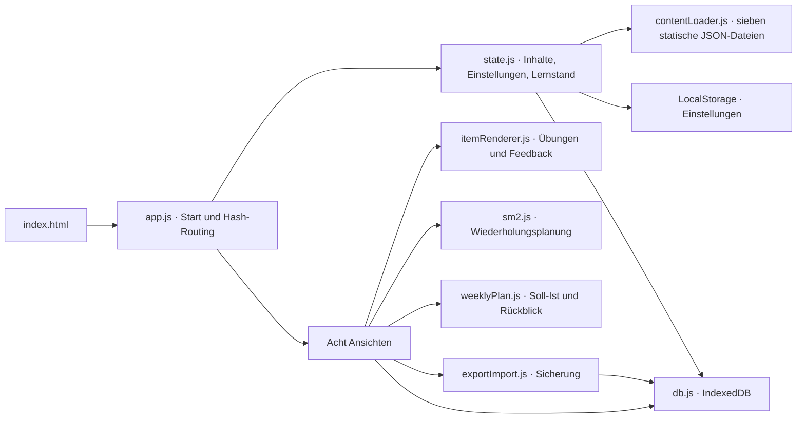

# Tiefenanalyse des Salesforce-Zertifizierungs-Trainers

**Prüfstand:** 26. November 2026 · Branch `main` · Commit `355cf3b34ede10a17b7bd4967700fa83390e6553`

## Ergebnis

Der Trainer startet lokal, führt durch die Lernpfadauswahl und speichert Lernaktivitäten dauerhaft im Browser. Der wichtigste Funktionsfehler betrifft den Kern des Lernsystems: Das Dashboard meldet fällige Aufgaben, die tägliche Einheit überspringt jedoch unter anderem falsch beantwortete Definitionsaufgaben. Der Inhaltsbestand liegt über den MVP-Mindestmengen, die Prüfungsgewichtungen stimmen mit Salesforce überein und die Kennzahlen benötigen Korrekturen, bevor sie zuverlässig als Maß für den Lernstand dienen können.

## 1. Prüfgrundlage

- **Reverse Engineer Anything (REA)** analysierte den ausgelieferten App-Ordner statisch. REA verarbeitete 18 JavaScript-Dateien ohne Syntaxfehler. Der statische Graph hat Teilabdeckung bei unter anderem dynamischen Aufrufen und Datenflüssen. Die Architekturzuordnung unten stützt sich zusätzlich auf direkt gelesene Module. REA-Evidenz: `ev_e3bd77cf1a813141ca27f50926663777660400c9305b0b7d67fc7c4b676c1e27`.
- **REA im Browser** führte in einem temporären Profil mit Chromium 158 das Onboarding, den Einstieg in eine Einheit, eine Vokabeleinführung, den Wechsel zur Fortschrittsansicht und eine Mini-Prüfung bis zur Auswertung aus. Danach erreichte der Lauf die Sicherungseinstellungen. Alle 16 definierten Schritte plus Startnavigation liefen durch. REA beendete den eigenen Browserprozess. Evidenz: `ev_8d7534755de138faa73508ecba2aa242d726b54c413f87c9399665a21d1a9102`.
- **Ergänzende Laufzeitprüfung** nutzte isolierte Chromium-Profile und synthetische Testdaten für Fälligkeit, Persistenz, Export und Import. Ein Durchlauf lief mit 390 × 844 CSS-Pixeln. Datumsfälle prüfte ich mit den unveränderten JS-Modulen und der Zeitzone Europe/Berlin.
- **Auslieferung:** Alle 30 Dateien im ZIP stimmen bytegenau mit den jeweiligen Dateien im App-Ordner überein. SHA-256 des ZIP: `e29ee57561ceadfbce902257390296a51bbf6a7148ade6eaf04f1cd663db78bc`. [ZIP](../sfz_app.zip)

## 2. Aufbau und Datenfluss

`index.html` lädt CSS und `app.js` als ES-Modul. Der Hash-Router wählt eine von acht Ansichten und erzwingt beim Erststart die Lernpfadauswahl. In der Oberfläche stehen danach Dashboard, Lernen, Prüfung, Glossar, Prüfungsenglisch, Fortschritt und Einstellungen zur Verfügung. Während der Initialisierung lädt der Trainer parallel alle sieben JSON-Dateien vom eigenen Ursprung sowie Fortschritt und Aktivitäten aus IndexedDB. Der Dateivergleich zeigt, dass der getestete Ordner die ausgelieferte ZIP-Version abbildet. [HTML](../sfz_app/index.html#L10), [Router und Start](../sfz_app/app.js#L13), [Initialisierung](../sfz_app/js/state.js#L57), [Inhaltslader](../sfz_app/js/contentLoader.js#L15)

Die Datenbank `salesforce-trainer-db` verwaltet den jüngsten Zustand je Content-ID, das Ereignisprotokoll und einen Marker für die einmalige Übernahme aus dem kombinierten Trainer. Eigene Einstellungen liegen unter `salesforce-trainer-settings`. Die App akzeptiert die Lernpfade Foundations, Administrator und Administrator inklusive Foundations. Im kombinierten Plan stammen neue Inhalte in den ersten fünf Wochen aus Foundations, danach aus Administrator. Die Wiederholungsabfrage berücksichtigt beide Zertifizierungen. [Datenbank](../sfz_app/js/db.js#L6), [Einstellungen und Lernpfade](../sfz_app/js/state.js#L7), [Zusammenstellung der Lerneinheit](../sfz_app/js/views/learn.js#L79)

Eine Lernrunde nimmt bis zu zehn fällige Aufgaben und bis zu zehn neue Elemente auf. Neue Vokabeln erscheinen als Karteikarte und zählen nach dem Bestätigen als eingeführt. Definitionen und Reading-Passagen geben direkt Feedback. Einzelne Szenariofragen bleiben dem Prüfungsbereich vorbehalten. Nach einer gewerteten Antwort berechnet SM-2 das Folgeintervall aus Korrektheit und Sicherheit. Die ersten erfolgreichen Wiederholungsstände erhalten Intervalle von einem und sechs Tagen. Bei einer falschen Antwort fallen die Erfolgswiederholungen auf null und die Aufgabe soll am Folgetag erneut erscheinen. Die Bestätigung der Karteikarte wurde im Browser als Fortschrittsdatensatz und Aktivitätsereignis gespeichert. Der Lernstand blieb beim Neuladen erhalten. [Lernmodus](../sfz_app/js/views/learn.js#L10), [SM-2](../sfz_app/js/sm2.js#L40), [Übungsdarstellung](../sfz_app/js/itemRenderer.js#L31)

Freies Üben und Mini-Prüfung nutzen denselben Fortschritt wie die Lerneinheit. Das freie Üben mischt die gefilterten Aufgaben. Die Mini-Prüfung nimmt bis zu zehn Szenariofragen oder Reading-Passagen aus dem gefilterten Pool, bei mindestens drei verfügbaren Aufgaben. Sie bietet zehn Minuten, Vor- und Zurücknavigation und eine gemeinsame Auswertung. Bei Mehrfachauswahl zählt die exakt richtige Auswahl. Die Quellen der Aufgaben und die Lösungen liegen zusammen in den lokalen JSON-Dateien. [Prüfungsmodus](../sfz_app/js/views/quiz.js#L36), [Auswertung](../sfz_app/js/views/quiz.js#L278)

## 3. Befunde nach Auswirkung

**P1** betrifft den Lernstand oder einen Kernablauf. **P2** betrifft Aussagekraft, Bedienbarkeit oder Zuverlässigkeit.

### P1 · Fällige Fehler erscheinen in der Lerneinheit nicht

SM-2 speichert eine falsche Antwort mit `repetitions: 0`, `flag: relearn` und einem Fälligkeitsdatum. Die Datenbank und das Dashboard zählen sie ab diesem Datum. Der Lernmodus akzeptiert fällige Einträge nur mit positiver Erfolgsserie oder Intro-Markierung. In der Neuauswahl fehlt die Aufgabe ebenfalls, weil sie schon einen Fortschrittsdatensatz hat. Für einzelne Szenariofragen kommt hinzu, dass sie im Lernpool grundsätzlich fehlen, obwohl das Dashboard ihre Fälligkeit mitzählt. [SM-2](../sfz_app/js/sm2.js#L49), [Fälligkeitsabfrage](../sfz_app/js/db.js#L80), [Dashboard](../sfz_app/js/views/dashboard.js#L13), [Lernpool](../sfz_app/js/views/learn.js#L88)

**Beobachtung:** Ein synthetisch zurückdatierter, fälliger Fehler zu `def-fnd-001` erzeugte im Browser „Heutige Einheit starten (1 fällig)“. Nach dem Start zeigte die Einheit „Neue Vokabel“. Der reproduzierte Fehler betrifft damit sowohl die Auswahl als auch die Übereinstimmung zwischen Anzeige und Lernrunde.

### P1 · Mini-Prüfungen können Lernstatistiken verfälschen

Im Browser erzeugte eine abgegebene Mini-Prüfung mit einer gewählten Antwort zehn gewertete Ereignisse. Die verbliebenen neun Aufgaben wurden als falsch verarbeitet. Für alle zehn Datensätze speicherte der Code den festen Sicherheitswert 3 und keine Bearbeitungszeit. Die Fortschrittsansicht übernimmt die 3 in den Mittelwert und verrechnet fehlende Dauer als null bei unverändertem Nenner. Ein Prüfungsversuch kann so zugleich die SM-2-Fälligkeit, die angezeigte Sicherheit und die angezeigte Durchschnittszeit verändern. [Prüfungsabgabe](../sfz_app/js/views/quiz.js#L278), [Gesamtstatistik](../sfz_app/js/views/progress.js#L16)

Der Timer zählt Intervalle ab und ruft beim Ablauf die Abgabe auf. Der Router oder ein neuer Prüfungsstart räumt den alten Timer nicht auf. Im Browser startete ich eine Prüfung, wechselte ohne Antwort zum Dashboard und ließ die simulierte Uhr bis zum Ablauf laufen. Der Trainer schrieb im Hintergrund zehn falsche Antworten, während das Dashboard geöffnet blieb. Beim Ersetzen einer aktiven Prüfung bleibt laut Code ebenfalls ein alter Timer bestehen. Bei Timerdrosselung kann außerdem die angezeigte Restzeit gegenüber der Uhr abweichen. [Timer und Abgabe](../sfz_app/js/views/quiz.js#L203), [Routenwechsel](../sfz_app/app.js#L61)

### P1 · Sicherungsimport kann bestehenden Lernstand durch einen leeren ersetzen

Export und Import funktionieren im Browser. In einem isolierten Profil ließ ich einen gültig strukturierten, aber leeren Salesforce-Testexport importieren. Die vorhandenen Fortschritts- und Aktivitätsdatensätze wurden durch zwei leere Speicher ersetzt. Die Anwendung weist oberhalb des Imports auf die Ersetzung hin. Nach Dateiauswahl schreibt sie direkt und meldet erst danach das Ergebnis. Beim separaten Zurücksetzen gibt es einen Bestätigungsdialog. Der Import liest die Trainerkennung und grundlegende Datenstrukturen, wertet `exportVersion` aber nicht aus und prüft weder jede Aufgaben-ID gegen den Katalog noch die Werte jedes Datensatzes. [Importlogik](../sfz_app/js/exportImport.js#L37), [Importoberfläche](../sfz_app/js/views/settings.js#L75)

Die Datenbank ersetzt Fortschritt und Aktivitäten gemeinsam in einer Transaktion. Das ist eine gute Grundlage für einen verlässlichen Import. Einstellungen werden anschließend separat in LocalStorage geschrieben. Normale Übungsantworten schreiben Fortschritt und Aktivität hingegen in zwei separaten Transaktionen. Bei Schreibfehlern oder konkurrierenden Tabs ist dadurch ein auseinanderlaufender Zustand möglich. Diese Nebenläufigkeit ist aus dem Code abgeleitet. [Transaktion beim Import](../sfz_app/js/db.js#L158), [Speichern der Lernantwort](../sfz_app/js/views/learn.js#L138)

### P2 · „Später wiederholen“ setzt keine Fälligkeit

Die Markierung im freien Üben schreibt nur `flag: later`. Bei einer neuen Aufgabe steht danach kein nächster Termin im Datensatz. Die Aufgabe verschwindet aus „Nur neue Inhalte“ und erscheint im Filter für später markierte Aufgaben. In der täglichen Einheit wird sie erst berücksichtigt, wenn ein anderer Ablauf eine passende Fälligkeit erzeugt. Bei einer bestehenden Fälligkeit ändert die Markierung den Termin nicht. Im Lernmodus erreicht der Priorisierer nur die bereits als fällig zugelassenen Datensätze. Für sie greift zuerst der Termin, weshalb das Flag innerhalb dieses Pfads keine zusätzliche Priorität erzeugt. [Manuelle Markierung und Filter](../sfz_app/js/views/quiz.js#L116), [Markierung speichern](../sfz_app/js/views/quiz.js#L185), [Priorisierung](../sfz_app/js/sm2.js#L141)

### P2 · Wochenplan und Kennzahlen geben ein verzerrtes Bild

- „Bearbeitet“ im Dashboard zählt eine positive aktuelle Erfolgsserie. Eine beantwortete Aufgabe zählt nach einem Fehler wieder als unbearbeitet. „Gefestigt“ setzt zwei erfolgreiche SM-2-Schritte und eine zuletzt richtige Antwort voraus. Auch unmittelbares erneutes Üben kann diese Schwelle erreichen, da keine Mindestzeit zwischen erfolgreichen Versuchen einfließt. [Dashboard](../sfz_app/js/views/dashboard.js#L56), [Domain-Abdeckung](../sfz_app/js/views/progress.js#L91)
- Die Empfehlung „Wochenziel weitgehend erreicht“ kann erscheinen, wenn die Wiederholungen erst zur Hälfte erfüllt sind und neue Vokabeln sowie Reading-Übungen fehlen. Der Wortlaut folgt aus einer Regel ohne Prüfung der beiden anderen Sollwerte. Zudem bestimmt das Feld Tagesziel in Minuten keine Rundenlänge. Die Runde verwendet feste Mengengrenzen. [Wochenempfehlung](../sfz_app/js/weeklyPlan.js#L120), [Tagesziel](../sfz_app/js/views/settings.js#L59), [Rundengrenzen](../sfz_app/js/views/learn.js#L10)
- Die Wochenplanung verwendet die Phase für die Zertifizierung. Der angezeigte Wochenfokus bestimmt nicht, welche Domain in der täglichen Einheit zuerst erscheint. Die App sortiert neue Aufgaben innerhalb eines Formats absteigend nach Gewichten. Die Mini-Prüfung zieht zufällig aus dem Filterpool. Damit prägen die Inhaltsmengen die Verteilung, einzelne Prüfungen haben keine verbindlichen Domain-Quoten. [Lernplanung](../sfz_app/js/views/learn.js#L102), [Prüfungsauswahl](../sfz_app/js/views/quiz.js#L45)
- Das Dashboard zeigt die Domain- und B1/B2-Abdeckung sowie einen Text zum Monatsmeilenstein. Im kombinierten Lernpfad fehlen getrennte Gesamtwerte pro Zertifizierung. Der Fortschrittsbereich bietet weder eine Auswertung pro Übungsformat noch einen kumulierten Monats-Soll-Ist-Wert. [Dashboard](../sfz_app/js/views/dashboard.js#L38), [Fortschritt](../sfz_app/js/views/progress.js#L45)

### P2 · Datumsgrenzen verschieben Fälligkeit und Wochenwerte

Die Wiederholungslogik addiert einen lokalen Kalendertag und speichert anschließend den UTC-Datumsteil. Der Test mit 26. November um 00:30 Uhr in Berlin ergab für eine neue Karte den 26. November als Fälligkeit, obwohl der nächste lokale Kalendertag der 27. November war. Die Wochenlogik rechnet mit festen 24-Stunden-Tagen. Am 30. März 2026 um 00:30 Uhr blieb ein am 23. März begonnener Plan deshalb noch in Woche 1. Nach Ablauf der zwölf Wochen bleibt die Anzeige auf Woche 12, deren historisches Datumsfenster spätere Aktivitäten ausschließt. Auch dieses Verhalten ließ sich mit den unveränderten JS-Funktionen bestätigen. [Fälligkeitsdatum](../sfz_app/js/sm2.js#L64), [Kalenderwochen](../sfz_app/js/weeklyPlan.js#L3)

### P2 · Tastaturbedienung und Fehler im Startvorgang

Im schmalen Testfenster passte die geprüfte Lernansicht ohne horizontales Dokument-Scrolling. Nach Auswahl einer Option in der Mini-Prüfung sprang der Fokus jedoch auf `BODY`, da der Code die Antwortschaltflächen sofort neu erzeugt. Für Antwortauswahl und Sicherheit basiert der sichtbare Zustand auf CSS-Klassen und fehlt als zugänglicher Auswahlzustand. In den Einstellungen ist der Datei-Input per `display: none` verborgen und das sichtbare Label nicht regulär fokussierbar. Der Sprunglink „Zum Inhalt springen“ wechselte im Test aus der Prüfungsansicht zum Dashboard, weil der Router `#app` als unbekannte Route behandelt. Englische Aufgaben in einem als Deutsch ausgezeichneten Dokument keine eigene Sprachangabe erhalten. [Antwortauswahl](../sfz_app/js/views/quiz.js#L252), [Sicherheitsskala](../sfz_app/js/itemRenderer.js#L306), [Upload](../sfz_app/js/views/settings.js#L84), [Dokumentsprache](../sfz_app/index.html#L2)

Die Ladefehler-Anzeige im Router greift erst nach erfolgreicher Initialisierung. Schlägt der Abruf eines JSON-Bestands oder das Öffnen der Datenbank beim Start fehl, kann „Lade Lerninhalte…“ stehen bleiben. Jedes der sieben JSON-Dokumente ist für den Start zwingend. Ein im Browser simulierter HTTP-503-Fehler beim Wochenplan bestätigte das Fehlerbild. Die Oberfläche blieb bei „Lade Lerninhalte…“, während der Fehler nur in der Browserkonsole erschien. [Startvorgang](../sfz_app/app.js#L70), [Inhaltsabruf](../sfz_app/js/contentLoader.js#L15)

## 4. Inhaltsbestand und Exam Outline

| Inhalt | Foundations | Administrator | Gesamt | MVP-Mindestmenge |
|---|---:|---:|---:|---:|
| Vokabeln | 84 | 156 | 240 | 40 |
| Definitionen | 42 | 68 | 110 | 15 |
| Einzelne Fragen | 70 | 120 | 190 | 30 |
| Reading-Passagen | 35 | 60 | 95 | 15 |
| Praxisaufgaben | 8 | 22 | 30 | 5 |
| Exam-Domains | 4 | 8 | 12 | – |

Die 665 Inhaltselemente haben eindeutige IDs und zur Zertifizierung passende Domain-Tags. Mit den 95 Teilfragen aus den Reading-Passagen gibt es 285 Fragen, davon 262 mit einer und 23 mit zwei richtigen Antworten. Jede heutige Passage enthält genau eine Teilfrage. Sechs Wiederholungen identischer normalisierter Fragetexte sind Kandidaten für eine redaktionelle Prüfung, weil derselbe Fragetext je nach Szenario etwas anderes prüfen kann. Separate Szenariofelder gibt es in `questions.json` nicht. Situationsbeschreibungen können im Fragetext stehen. Alle 665 Elemente haben eine textuelle Quellenreferenz. Vollständige fachliche, sprachdidaktische oder urheberrechtliche Einzelprüfung war außerhalb dieses Tests. [Vokabular](../sfz_app/data/vocabulary.json), [Definitionen](../sfz_app/data/definitions.json), [Fragen](../sfz_app/data/questions.json), [Passagen](../sfz_app/data/reading-passages.json), [Praxis](../sfz_app/data/practice-tasks.json)

| Administrator-Domain | Exam Guide | Einzelfragen | Reading |
|---|---:|---:|---:|
| Data and Analytics Management | 17 % | 21 | 10 |
| Configuration and Setup | 15 % | 18 | 8 |
| Object Manager and Lightning App Builder | 15 % | 17 | 8 |
| Automation | 15 % | 18 | 9 |
| Sales and Marketing Applications | 10 % | 12 | 7 |
| Service and Support Applications | 10 % | 11 | 6 |
| Productivity and Collaboration | 10 % | 12 | 7 |
| Agentforce | 8 % | 11 | 5 |

Die zwölf App-Gewichte stimmen mit den offiziellen Guides überein. Für Foundations lautet die Verteilung 32 % Salesforce Ecosystem, 28 % Navigation, 25 % Data Model und 15 % Reports & Dashboards. Bei Administrator entfallen 74 der 120 Einzelfragen auf die vier am höchsten gewichteten Domains. Das sind rund 61,7 % bei zusammen 62 % Exam-Gewicht. [App-Domains](../sfz_app/data/exam-domains.json), [Salesforce Platform Foundations Exam Guide](https://help.salesforce.com/s/articleView?id=005298979&language=en_US&type=1), [Salesforce Platform Administrator Exam Guide](https://help.salesforce.com/s/articleView?id=005298966&language=en_US&type=1)

Die Prüfungsinformationen im Onboarding treffen Dauer, reguläre Fragenzahl, englische Bestehensgrenze und die genannten USD-Grundgebühren. Salesforce nennt zusätzlich bis zu fünf ungewertete Fragen pro Prüfung. Die Aussage, der reine Administrator-Pfad setze eine bestandene Foundations-Prüfung voraus, steht im App-Untertitel und widerspricht der gleichzeitig angezeigten Erläuterung. Salesforce nennt für den Administrator keine formale Voraussetzung und empfiehlt mindestens sechs Monate praktische Administrator-Erfahrung. B1 und B2 sind Einstufungen des Lernmaterials durch die App. Die abgeglichenen Exam Guides geben dafür kein CEFR-Niveau vor. [Onboarding](../sfz_app/js/views/onboarding.js#L6), [Salesforce Platform Foundations Exam Guide](https://help.salesforce.com/s/articleView?id=005298979&language=en_US&type=1), [Salesforce Platform Administrator Exam Guide](https://help.salesforce.com/s/articleView?id=005298966&language=en_US&type=1)

## 5. Auslieferung und lokaler Betrieb

Im ergänzenden Browserdurchlauf gingen die beobachteten Requests ausschließlich an den lokalen Testursprung. Alle sieben Inhaltsdateien wurden geladen. Es traten in diesem Lauf keine unbehandelten Browserfehler auf. Der Host der Testinstanz war explizit an 127.0.0.1 gebunden. Die mitgelieferten Startskripte rufen den Python-Server ohne Loopback-Bindung auf. Je nach Betriebssystem und Firewall kann dadurch auch ein anderes Gerät im Netz die statischen Dateien erreichen. Der Lernstand selbst liegt im jeweiligen Browserprofil. Er hängt technisch auch an Protokoll, Host und Port. Wechselt das Startskript bei belegtem Port auf einen freien Port, sieht derselbe Browser dort einen separaten Lernstand. [macOS-Start](../sfz_app/start-server-mac.command#L32), [Windows-Start](../sfz_app/start-server-windows.bat#L18), [Speichermodell](../sfz_app/js/state.js#L7)

### Übernahme aus dem kombinierten Trainer

Ein synthetischer Altbestand mit einem Salesforce- und einem HubSpot-Datensatz pro Speicher übernahm ausschließlich Salesforce-Fortschritt und Salesforce-Aktivität. Ein zweiter Start erzeugte keine Duplikate. Das passt zur Implementierung, die Inhalte nach Zertifizierung auswählt und den einmaligen Marker gemeinsam mit den migrierten Daten schreibt. Die Übernahme setzt denselben Browserursprung und dasselbe Profil voraus. Ein Profil mit einem bereits gesetzten Migrationsmarker übernimmt spätere Änderungen am Altbestand nicht erneut. Für den Wechsel auf einen anderen Ursprung dient der JSON-Import. [Migrationslogik](../sfz_app/js/db.js#L114), [Zertifizierungsfilter](../sfz_app/js/learningScope.js#L1)

## 6. Reihenfolge für die Nacharbeit

| Reihenfolge | Arbeit | Abnahmekriterium |
|---|---|---|
| 1 | Fälligkeit, Lernpool und Dashboard auf dieselbe Aufgabenmenge beziehen. Manuelle Markierung mit Termin oder eigener Lernliste verbinden. | Ein tatsächlich fälliger Fehler, eine terminierte Markierung und eine bereits eingeführte Vokabel erscheinen zugänglich in der Lernrunde. Anzeige und Warteschlange erklären denselben Bestand. |
| 2 | Mini-Prüfungen beim Verlassen und Neustart beenden. Unbeantwortet, falsch und unbeobachtete Messwerte im Ereignismodell unterscheiden. | Ein abgebrochener Versuch schreibt nach Ablauf der Uhr keine Antworten. Die Ergebnisanzeige kennzeichnet offene Fragen und Mittelwerte verwenden nur vorhandene Messwerte. |
| 3 | Sicherung vor Ersetzung validieren und eine Vorschau mit Bestätigung ergänzen. Normale Antworten zusammen mit ihrem Aktivitätsereignis speichern. | Gültige frühere Sicherungen funktionieren. Leere oder fehlerhafte Daten werden vor dem Schreiben sichtbar, und ein gescheiterter Schreibvorgang hinterlässt keinen Teilstand. |
| 4 | Berechnungen auf lokale Kalendertage stützen und Kennzahlen fachlich schärfen. | Mitternacht, Zeitumstellung und Woche 13 haben definierte Ergebnisse. „Bearbeitet“, „gefestigt“ und Wochenziele lassen sich anhand weniger Testereignisse nachvollziehen. |
| 5 | Start- und Tastaturbedienung nachziehen. Prüfungshinweise und Domain-Verteilung aus überprüfbaren Daten erzeugen. | Startfehler erklären den fehlgeschlagenen Schritt. Tastaturfokus bleibt beim Antworten erhalten. Das Onboarding stimmt mit den Guides überein. |

Die Analyse deckt reguläre und ausgewählte fehlerhafte Abläufe in Chromium ab. Safari, Firefox, native Mobilgeräte, Screenreader, Windows-Start und eine vollständige visuelle Prüfung aller Ansichten bleiben offen. Eine automatisierte Test-Suite für diese App war im geprüften Repository nicht vorhanden. Die Befunde entstanden aus REA-Szenarien, gezielten Chromium- und JS-Tests, Inhaltszählungen und dem Abgleich mit den beiden offiziellen Exam Guides.
